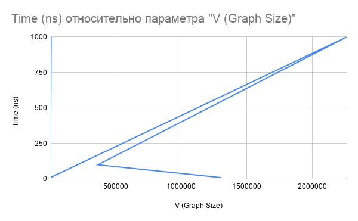
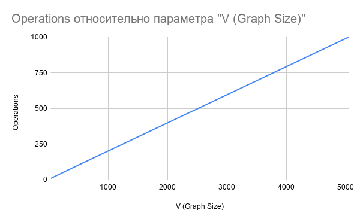

# Assignment 3: Smart City Infrastructure and Route Planning

## 1. Complexity Analysis
- **DSU (Disjoint Set Union):** `find` and `union` operations take almost $O(1)$ amortized time because of path compression and union by rank.
- **Kruskal's Algorithm:** $O(E \log E)$ because we need to sort all edges first.
- **Prim's Algorithm:** $O(E \log V)$ using Priority Queue (Min-Heap).
- **Topological Sort:** $O(V + E)$ using standard DFS.
- **Kosaraju's Algorithm (SCC):** $O(V + E)$ because it uses two DFS passes and graph transposition.
- **Dijkstra's Algorithm:** $O(E \log V)$ using Priority Queue with lazy decrease-key pattern.

## 2. Benchmark Results
Here is the table of my benchmark results for different graph sizes:

| Algorithm | V = 10 (ns) | V = 100 (ns) | V = 1000 (ns) |
| :--- | :--- | :--- | :--- |
| **Kruskal MST** | 1,023,300 | 785,300 | 4,344,800 |
| **Prim MST** | 786,300 | 921,300 | 3,164,600 |
| **Kosaraju SCC** | 1,003,900 | 557,900 | 3,554,600 |
| **Dijkstra Time** | 1,302,200 | 362,900 | 2,265,800 |
| **Topological Sort**| 54,800 | 90,800 | 788,100 |

*Note: In some cases, V=100 is faster than V=10. This is a classic Java JVM Warm-up effect where the JIT compiler optimizes the code after the first run.*

### Dijkstra Operations Count
- **V = 10:** 36 operations
- **V = 100:** 486 operations
- **V = 1000:** 5,053 operations

## 3. Plots
**Plot 1: Dijkstra Execution Time vs Graph Size**

**Plot 2: Dijkstra Operations vs Graph Size**

## 4. Conclusion
From the experimental results, we can see that Prim's algorithm works slightly faster than Kruskal's for these generated graphs. Topological sort is the fastest algorithm because it only visits nodes once without heavy data structures. Dijkstra's operation count grows proportionally to the number of edges, which practically proves its $O(E \log V)$ theoretical complexity.